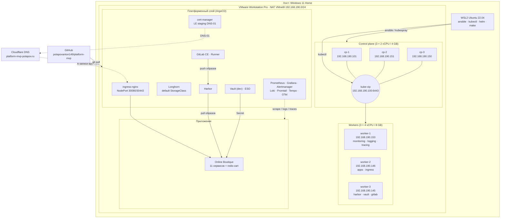
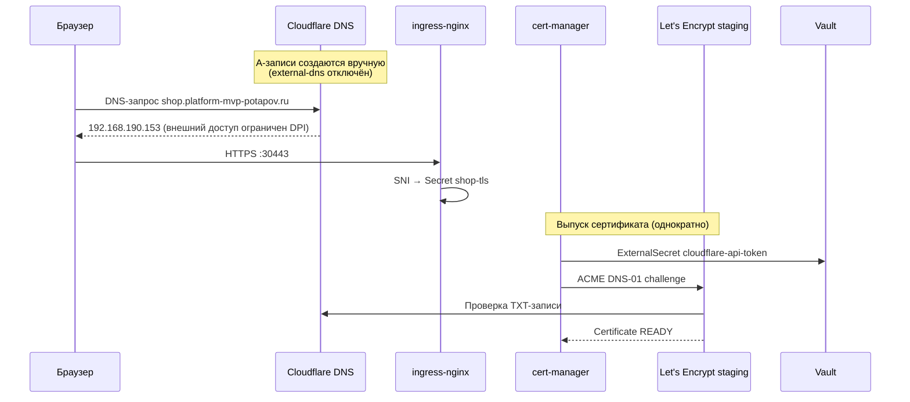
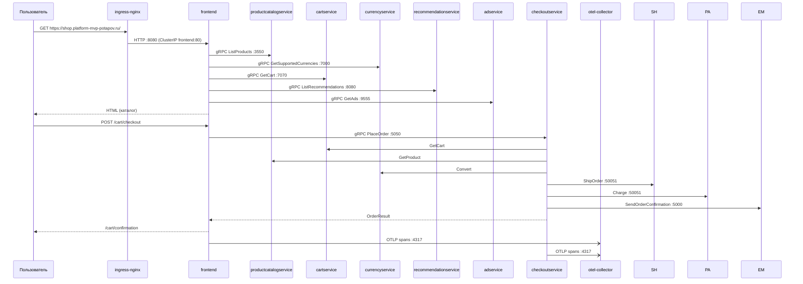
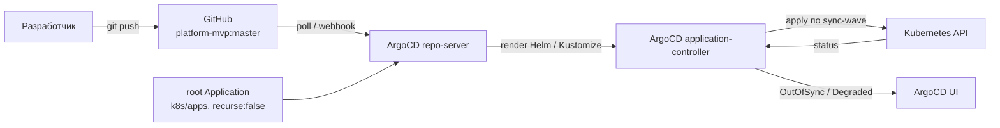
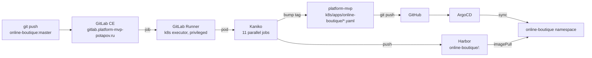
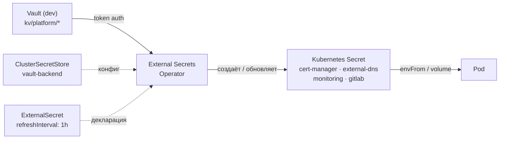
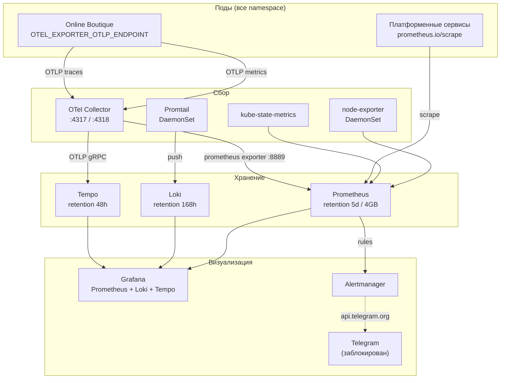

# Архитектура платформы

Документ описывает, из чего состоит платформа, как компоненты связаны между
собой и почему выбраны именно такие решения. Все версии соответствуют
фактически развёрнутому состоянию кластера.

- [1. Общая схема](#1-общая-схема)
- [2. Уровни платформы](#2-уровни-платформы)
- [3. Сеть](#3-сеть)
- [4. Поток пользовательского запроса](#4-поток-пользовательского-запроса)
- [5. GitOps-поток](#5-gitops-поток)
- [6. CI/CD-поток](#6-cicd-поток)
- [7. Поток секретов](#7-поток-секретов)
- [8. Observability](#8-observability)
- [9. Решения и обоснования](#9-решения-и-обоснования)

---

## 1. Общая схема



---

## 2. Уровни платформы

Платформа разделена на четыре уровня. Каждый следующий уровень зависит только
от предыдущего, что позволяет пересоздавать кластер, не трогая описания
сервисов.

| Уровень | Что входит | Инструмент управления | Где описано |
|---|---|---|---|
| **1. Инфраструктура** | 6 VM, NAT-сеть, диски, SSH-доступ | VMware GUI (вручную) | [deployment.md](deployment.md) |
| **2. Kubernetes** | kubeadm-кластер, etcd, Cilium, kube-vip, containerd | Ansible + Kubespray | [`ansible/`](../ansible), [`kubespray-config/`](../kubespray-config) |
| **3. Платформа** | ingress, TLS, storage, observability, secrets, registry, CI | ArgoCD (GitOps) | [`k8s/apps/`](../k8s/apps), [`k8s/values/`](../k8s/values) |
| **4. Приложение** | Online Boutique | ArgoCD (Kustomize) | [`k8s/apps/online-boutique/`](../k8s/apps/online-boutique) |

### Границы автоматизации

| Слой | Автоматизация | Обоснование |
|---|---|---|
| Создание VM в VMware | Ручное (GUI) | Одноразовая операция; живого Terraform-провайдера для VMware Workstation нет |
| Подготовка ОС | Ansible роль `common` | Идемпотентно, воспроизводимо |
| Установка Kubernetes | Kubespray v2.26.0 | Стандарт Kubernetes SIGs, HA из коробки |
| Bootstrap ArgoCD | Ansible роль `argocd` | Единственный компонент, который ставится вне GitOps (курица и яйцо) |
| Всё остальное | ArgoCD | Декларативно, версионируется, drift detection |

### Два процесса

| Процесс | Что делает | Инструменты | Результат |
|---|---|---|---|
| **1. Платформа** | Готовит ОС, ставит k8s, bootstrap ArgoCD | Ansible + Kubespray | «Голый» кластер + ArgoCD |
| **2. Сервисы и приложение** | Раскатывает обвязку и приложение | ArgoCD (GitOps) | Работающая платформа + приложение |

---

## 3. Сеть

### 3.1. Сегментация

| Сеть | CIDR | Назначение |
|---|---|---|
| VMware NAT (VMnet8) | `192.168.190.0/24` | Все 6 VM + VIP |
| Pod network | `10.244.0.0/16` | Cilium, `k8s_pod_cidr` |
| Service network | `10.96.0.0/12` | ClusterIP, `k8s_service_cidr` |
| Cluster domain | `cluster.local` | CoreDNS |

VMware NAT выбран потому, что VM не должны быть видны из домашней сети, но
должны иметь интернет (для pull образов и ACME DNS-01) и быть доступны с хоста
через WSL2.

### 3.2. Адресация нод

| Нода | IP | Метки (post-kubespray) |
|---|---|---|
| cp-1 | 192.168.190.101 | control-plane, etcd |
| cp-2 | 192.168.190.151 | control-plane, etcd |
| cp-3 | 192.168.190.150 | control-plane, etcd |
| worker-1 | 192.168.190.153 | `monitoring=true`, `logging=true` |
| worker-2 | 192.168.190.146 | `storage=true` |
| worker-3 | 192.168.190.145 | `ingress=true` |
| **kube-vip** | **192.168.190.100** | VIP API-сервера |

Метки навешиваются playbook'ом
[`ansible/playbooks/03-post-kubespray.yml`](../ansible/playbooks/03-post-kubespray.yml)
из переменной `node_labels` в
[`ansible/inventory/group_vars/all.yml`](../ansible/inventory/group_vars/all.yml).

### 3.3. HA control plane

kube-vip работает в режиме ARP: один из control-plane узлов анонсирует
`192.168.190.100` через gratuitous ARP, при падении лидера адрес переезжает на
другой узел (leader election). Настройки в
[`kubespray-config/group_vars/k8s_cluster/k8s-cluster.yml`](../kubespray-config/group_vars/k8s_cluster/k8s-cluster.yml):

```yaml
kube_vip_enabled: true
kube_vip_controlplane_enabled: true
kube_vip_address: 192.168.190.100
kube_vip_interface: ens33
kube_vip_cidr: 32
kube_vip_arp_enabled: true
kube_vip_leader_election_enabled: true
kube_vip_lb_enable: false
supplementary_addresses_in_ssl_keys:
  - 192.168.190.100
```

`supplementary_addresses_in_ssl_keys` обязателен: без него сертификат
API-сервера не содержит VIP, и `kubectl` падает на TLS-проверке.

### 3.4. CNI и kube-proxy

| Параметр | Значение | Комментарий |
|---|---|---|
| CNI | Cilium v1.16.1 | eBPF, Hubble UI включён |
| `kube_proxy_mode` | `ipvs` | Kubespray ставит kube-proxy в режиме IPVS |
| `kube_proxy_remove` | `false` | kube-proxy остаётся |
| `cilium_kube_proxy_replacement` | `false` | Cilium **не** заменяет kube-proxy |

Комбинация «kube-proxy IPVS + Cilium без kube-proxy replacement» выбрана
осознанно: Kubespray v2.26.0 передаёт в Cilium значение `False` (Python-строка),
а Cilium 1.16 ожидает `false` (Go-строка) — при включении replacement Cilium
падает в `CrashLoopBackOff`. Подробнее —
[troubleshooting.md → Cilium](troubleshooting.md#cilium).

### 3.5. Ingress

ingress-nginx 4.11.3 развёрнут как **DaemonSet** с `hostNetwork`-подобной
моделью через NodePort:

| Параметр | Значение |
|---|---|
| Kind | DaemonSet |
| Service type | NodePort |
| HTTP | 30080 |
| HTTPS | 30443 |
| IngressClass | `nginx` (default) |
| `use-forwarded-headers` | `true` |
| `enable-real-ip` | `true` |
| `proxy-real-ip-cidr` | `0.0.0.0/0` |

DaemonSet выбран, чтобы ingress-поды были на каждой ноде и NodePort работал с
любого адреса. Логи ingress пишутся в JSON-формате
(`log-format-upstream`) — это позволяет Loki парсить поля без regex.

### 3.6. DNS и TLS



| Хост | Secret | ClusterIssuer |
|---|---|---|
| vault | `vault-tls` | `letsencrypt-staging` |
| harbor | `harbor-tls` | `letsencrypt-staging` |
| longhorn | `longhorn-tls` | `letsencrypt-staging` |
| grafana | `grafana-tls` | `letsencrypt-staging` |
| prometheus | `prometheus-tls` | `letsencrypt-staging` |
| alertmanager | `alertmanager-tls` | `letsencrypt-staging` |
| gitlab | `gitlab-wildcard-tls` | self-signed (chart) |
| shop | `shop-tls` | `letsencrypt-staging` |

cert-manager запускается с флагами, заставляющими использовать внешние
резолверы (иначе DNS-01 не проходит из-за локального CoreDNS):

```yaml
extraArgs:
  - --dns01-recursive-nameservers-only
  - --dns01-recursive-nameservers=1.1.1.1:53,8.8.8.8:53
```

---

## 4. Поток пользовательского запроса



Все межсервисные вызовы — gRPC по ClusterIP-сервисам внутри namespace
`online-boutique`. Внешний трафик входит только через ingress на `frontend:80`.

---

## 5. GitOps-поток



### App of Apps

Единственный Application, созданный вручную (Ansible-ролью `argocd`), —
[`k8s/bootstrap/root-app.yaml`](../k8s/bootstrap/root-app.yaml):

```yaml
spec:
  source:
    repoURL: https://github.com/potapovanton149/platform-mvp.git
    targetRevision: master
    path: k8s/apps
    directory:
      recurse: false      # критично: иначе манифесты приложения
                          # применяются в namespace argocd
  destination:
    namespace: argocd
  syncPolicy:
    automated: {prune: true, selfHeal: true}
```

`recurse: false` — обязательное условие. При `recurse: true` ArgoCD обходит
`k8s/apps/online-boutique/` и пытается применить манифесты приложения в
namespace `argocd`, что ломает деплой.

### Sync-waves

Порядок раскатки задаётся аннотацией
`argocd.argoproj.io/sync-wave`. Отрицательные волны применяются раньше.

| Wave | Applications | Зависимость |
|---|---|---|
| −1 | `namespaces` | Все namespace должны существовать |
| 0 | `ingress-nginx`, `cert-manager`, `clusterissuers`, `external-dns` | Базовый сетевой слой |
| 1 | `longhorn` | StorageClass для всех PVC |
| 2 | `kube-prometheus-stack`, `loki`, `promtail`, `tempo`, `otel-collector`, `external-secrets`, `vault`, `platform-certs` | Требуют Longhorn; Certificate требуют cert-manager |
| 3 | `harbor` | Требует Longhorn + ingress |
| 4 | `gitlab`, `gitlab-runner` | Требует Longhorn + ingress + Harbor |
| 5 | `gitlab-external-secrets`, `platform-alerts` | Требуют ESO/Vault и Prometheus |
| default | `online-boutique` | Требует Harbor (образы) + ingress |

### Особенности Application-манифестов

| Приём | Где | Зачем |
|---|---|---|
| Multi-source (`sources` + `ref: values`) | почти все | Values лежат в этом же репозитории, чарт — во внешнем Helm-репо |
| `ServerSideApply=true` | ingress-nginx, cert-manager, longhorn, monitoring, loki, tempo, otel, vault | CRD слишком большие для client-side apply (лимит 262144 байт) |
| `ignoreDifferences` на `volumeClaimTemplates` | monitoring, loki, tempo, online-boutique | K8s не позволяет менять VCT у существующего StatefulSet — иначе вечный OutOfSync |
| `ignoreDifferences` на `/spec/strategy` | harbor | Harbor сам меняет стратегию rollout при Multi-Attach |
| `RespectIgnoreDifferences=true` | tempo, harbor | Без него `selfHeal` откатывает игнорируемые поля |
| `retry` с backoff | longhorn, monitoring, loki, tempo, otel | CRD и webhook'и появляются не мгновенно |
| `CreateNamespace=false` | online-boutique, platform-certs, platform-alerts | Namespace создаётся Application'ом `namespaces` |

---

## 6. CI/CD-поток



| Шаг | Инструмент | Результат |
|---|---|---|
| Build | Kaniko `v1.23.2-debug` | Образ без Docker daemon |
| Push | Kaniko → Harbor | `harbor.platform-mvp-potapov.ru/online-boutique/<svc>:<sha>` |
| Bump | `sed` + `git commit` | Новый тег в манифестах |
| Deploy | ArgoCD auto-sync | Rolling update |

CI **не имеет доступа к кластеру** — только к git и Harbor. Это стандартная
практика: единственный, кто пишет в кластер, — ArgoCD.

Детали — [ci-cd.md](ci-cd.md).

---

## 7. Поток секретов



| ExternalSecret | Namespace | Целевой Secret | Ключи |
|---|---|---|---|
| `cloudflare-api-token` | `cert-manager` | `cloudflare-api-token` | `api-token` |
| `cloudflare-api-token` | `external-dns` | `cloudflare-api-token` | `cloudflare_api_token` |
| `telegram-alertmanager` | `monitoring` | `alertmanager-telegram` | `bot-token`, `chat-id` |
| `gitlab-root-password` | `gitlab` | `gitlab-gitlab-initial-root-password` | `password` |
| `harbor-credentials` | `gitlab` | `harbor-credentials` | `HARBOR_USER`, `HARBOR_PASSWORD` |

Обратите внимание: два ExternalSecret с именем `cloudflare-api-token` в разных
namespace создают Secret'ы с **разными именами ключей** — cert-manager ждёт
`api-token`, external-dns ждёт `cloudflare_api_token`. Это не опечатка, а
требование чартов.

Детали — [security.md](security.md).

---

## 8. Observability



| Сигнал | Источник | Хранилище | Retention | Доступ |
|---|---|---|---|---|
| Метрики | node-exporter, kube-state-metrics, ServiceMonitor, pod annotations | Prometheus | 5 дней / 4 GB | Grafana, Prometheus UI |
| Логи | Promtail (DaemonSet, `/var/log/pods`) | Loki (SingleBinary, filesystem) | 168 ч | Grafana Explore |
| Трейсы | OTel Collector (OTLP) | Tempo (local backend) | 48 ч | Grafana Explore |

Grafana настроена на корреляцию: из трейса можно перейти в логи
(`tracesToLogsV2`) и в метрики (`tracesToMetrics`), из логов — в трейс
(`lokiSearch`).

Детали — [monitoring.md](monitoring.md).

---

## 9. Решения и обоснования

### 9.1. Почему Kubespray, а не свой Ansible

Написать собственный Ansible для `kubeadm init/join` с HA control plane,
etcd-кворумом, kube-vip и rolling upgrade — это недели работы и высокая
вероятность застрять на отладке. Kubespray — официальный инструмент Kubernetes
SIGs, де-факто стандарт для self-managed кластеров. Ценность проекта создаётся
не в установке k8s, а вокруг него: GitOps, CI/CD, observability, безопасность,
приложение.

При этом Kubespray не «чёрный ящик»: конфигурация вынесена в
[`kubespray-config/`](../kubespray-config), а сам он подключён как git submodule
с фиксированной версией v2.26.0.

### 9.2. Почему Longhorn, а не local-path / NFS

| Критерий | Longhorn | local-path | NFS |
|---|---|---|---|
| Репликация | Да (настраивается) | Нет | Нет |
| UI | Да | Нет | Нет |
| Snapshot / backup | Да | Нет | Нет |
| Работа на 3 нодах | Да | Да | Нужен отдельный сервер |
| Установка | Helm-чарт | Встроен в Kubespray | Ручная |

Longhorn даёт репликацию и UI без внешнего хранилища. В учебном окружении
`defaultReplicaCount: 1` (экономия диска), в production — 3.

### 9.3. Почему Harbor, а не Docker Hub / GitLab Registry

- Приватный реестр внутри кластера — не зависит от внешних блокировок.
- Trivy-сканирование из коробки.
- Проекты с разными правами (`online-boutique` public, `platform` private).
- GitLab Registry включён, но Harbor выбран как основной: он даёт UI,
  сканирование и политики retention.

### 9.4. Почему Vault + ESO, а не просто Secret'ы в git

Secret в git — это пароль в открытом виде в истории репозитория. Vault + ESO
дают:

- Единый источник истины для секретов.
- Ротацию без пересборки манифестов (`refreshInterval: 1h`).
- Аудит доступа (в production-режиме).
- Секреты не попадают в git вообще.

В учебном проекте Vault работает в dev-режиме (данные в памяти) — компромисс
ради простоты. Переход в production описан в [security.md](security.md).

### 9.5. Почему ArgoCD, а не Flux

Оба — CNCF-проекты. ArgoCD выбран за:

- App of Apps с явными sync-waves (у Flux порядок задаётся через
  `dependsOn`, что менее наглядно).
- Визуальное дерево ресурсов — критично для демонстрации.
- `ignoreDifferences` с `jqPathExpressions` — гибче, чем у Flux.
- Более распространён в вакансиях и, соответственно, полезнее для портфолио.

### 9.6. Почему GitLab CE, а не GitHub Actions

Требование — self-hosted CI/CD внутри кластера. GitLab CE даёт git-сервер,
реестр, CI-движок и UI в одном чарте. GitHub Actions требует внешнего раннера и
недоступен при блокировках.

### 9.7. Почему Cilium без kube-proxy replacement

См. [3.4](#34-cni-и-kube-proxy). Кратко: несовместимость типов в Kubespray
v2.26.0 → Cilium 1.16.1. Включение replacement требует ручного патча
`cilium-config` после установки, что и делается в
[`scripts/02-run-kubespray.sh`](../scripts/02-run-kubespray.sh), но
`kube-proxy-replacement` там выставляется в `false` — то есть kube-proxy
остаётся основным.

### 9.8. Почему Let's Encrypt staging

При отладке DNS-01 и ingress-конфигурации легко превысить лимиты production
CA (5 ошибок валидации в час → блокировка на неделю). Staging не имеет таких
лимитов. Переключение на prod — одна строка в аннотации ingress
(`cert-manager.io/cluster-issuer: letsencrypt-prod`), ClusterIssuer уже
подготовлен в
[`k8s/manifests/clusterissuer-letsencrypt-prod.yaml`](../k8s/manifests/clusterissuer-letsencrypt-prod.yaml).

---

## Связанные документы

- [deployment.md](deployment.md) — как это развернуть
- [troubleshooting.md](troubleshooting.md) — что ломалось и как починили
- [monitoring.md](monitoring.md) — observability
- [security.md](security.md) — секреты
- [ci-cd.md](ci-cd.md) — пайплайн
- [application.md](application.md) — приложение
- [known-limitations.md](known-limitations.md) — ограничения
